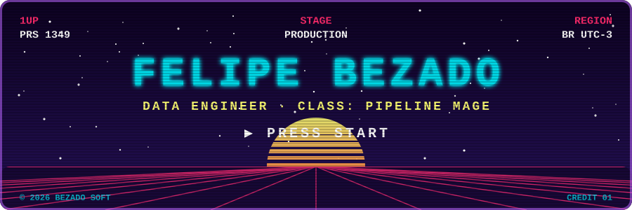

<p align="center">
  
</p>

<p align="center">
  <a href="https://github.com/felipe-bezado">
    
  </a>
</p>

<p align="center">
  <a href="https://www.linkedin.com/in/felipe-bezado/"></a>
  
</p>

---

<p align="center">
  
</p>

## 🎮 Choose your level

<details open>
<summary><b>🗺️ WORLD 1: The Data Realm</b> <i>(click to collapse)</i></summary>
<br/>

I'm a **Data Engineer** at a Brazilian retail-intelligence company. My realm: a fleet of **~100 Cloud Run jobs and services** (59 of them shipped or rebuilt by me) that move data from retailers, ERPs, e-commerce platforms and inboxes into **BigQuery**, then out again as dashboards, alerts and AI answers.

| Zone | What lives there |
|---|---|
| 📦 **Sellout Plains** | retailer spreadsheets of every shape → AI-assisted parsing → audited BigQuery loads |
| 💸 **Pricing Peaks** | competitor price mapping: official API first, plain scraping second, LLM last |
| 🚚 **Logistics Docks** | carrier tracking, freight-quote inbox readers, delivery alerts |
| 📊 **Dashboard City** | a hub of internal FastAPI dashboards behind one SSO, each with its own Claude chat |
| 🧮 **Cost Control Tower** | GCP billing export, daily cost digest, scale-to-zero rotation for idle apps |

</details>

<details>
<summary><b>📜 QUEST LOG</b> <i>(click to open)</i></summary>
<br/>

**⚔️ Current quest**
- [ ] Retire the last no-code automations and rebuild them as tested Cloud Run jobs
- [ ] Self-healing sellout chain: every load proves itself before it says "done"

**✅ Main quests completed**
- [x] **Data Center**: one hub, one login, many dashboards, relay-JWT auth with per-card access control
- [x] **AI-in-the-loop email reader**: Gmail → 2 AI judges + 1 arbiter → a daily freight close nobody types by hand
- [x] **Dashboard chat**: Claude with tools over BigQuery, streaming answers and HTML reports
- [x] **Shared dev kit**: one Python library for secrets, BigQuery, auth and telemetry across every job
- [x] **Homemade PR quality gate**: lint + changed-line coverage + a review bot, 90% coverage house rule

**🧩 Side quests**
- [x] Internal **Claude Code plugin marketplace** for the team (deploy, debug, QA, design skills)
- [x] An **Obsidian second brain** wired to Claude's memory, so context survives between sessions
- [x] Slack alerts for failed jobs, a morning health check, and a "check jobs" report on demand

</details>

<details>
<summary><b>🐉 BOSSES DEFEATED</b> <i>(click to open)</i></summary>
<br/>

| Boss | Attack | How it fell | Loot |
|---|---|---|---|
| 🐉 **The Expiration Dragon** | a 60-day dataset default silently ate tables overnight | audit + explicit expiration policy | *never trust a default* |
| 🐍 **The Duplicate Hydra** | cut one load, two copies grow back | idempotent writes keyed per period | *rerun-safe pipelines* |
| ⏰ **The UTC Goblin** | cron fired 3 hours late | schedules pinned to local time, timestamps stored in UTC | *timezone armor* |
| 🕷️ **The Schema Drift Spider** | an API quietly renamed its fields | never append a raw API frame, never delete before write | *contract tests* |
| 🧟 **The Un-awaited DML Zombie** | a query that "finished" before it ran | always `.result()` before the next write | *race immunity* |
| 👻 **The Cold Start Specter** | idle apps burning money all night | telemetry-ranked warm rotation, scale-to-zero after hours | **-55% idle cost** |

</details>

---

## 🎒 Inventory

<p align="center">
  
  <br/>
  
</p>

<p align="center">
  
  
  
  
  
  
  
  
  
  
  
  
</p>

<details>
<summary><b>🔍 Inspect items</b></summary>
<br/>

| Item | Rarity | Effect |
|---|---|---|
| 🐍 Python + Poetry | ⭐⭐⭐⭐⭐ Legendary | every job, every service, locked dependencies |
| 🔷 BigQuery | ⭐⭐⭐⭐⭐ Legendary | the save file of the whole realm |
| ☁️ Cloud Run | ⭐⭐⭐⭐ Epic | jobs on a schedule, services that sleep when nobody looks |
| 🤖 Claude API | ⭐⭐⭐⭐ Epic | parsing, judging, summarizing, chatting with data |
| ⚙️ GitHub Actions | ⭐⭐⭐ Rare | CI, quality gate, deploy on merge |
| 🎭 Playwright | ⭐⭐⭐ Rare | headless QA for every dashboard before it ships |

</details>

---

<p align="center">
  
</p>

## 🐍 Bonus stage: the snake eats my contributions

<p align="center">
  <picture>
    <source media="(prefers-color-scheme: dark)" srcset="https://raw.githubusercontent.com/felipe-bezado/Felipe-Bezado/output/github-snake-dark.svg"/>
    <source media="(prefers-color-scheme: light)" srcset="https://raw.githubusercontent.com/felipe-bezado/Felipe-Bezado/output/github-snake.svg"/>
    
  </picture>
</p>

<p align="center">
  
</p>

<details>
<summary><b>🔒 ↑ ↑ ↓ ↓ ← → ← → B A</b></summary>
<br/>

```text
CHEAT CODE ACCEPTED
+30 lives granted
> SELECT * FROM bugs WHERE fixed = FALSE;
0 rows returned.
(for now)
```

</details>

<p align="center">
  
  <br/><sub>GAME OVER? Never. INSERT COIN TO CONTINUE 🪙</sub>
</p>
